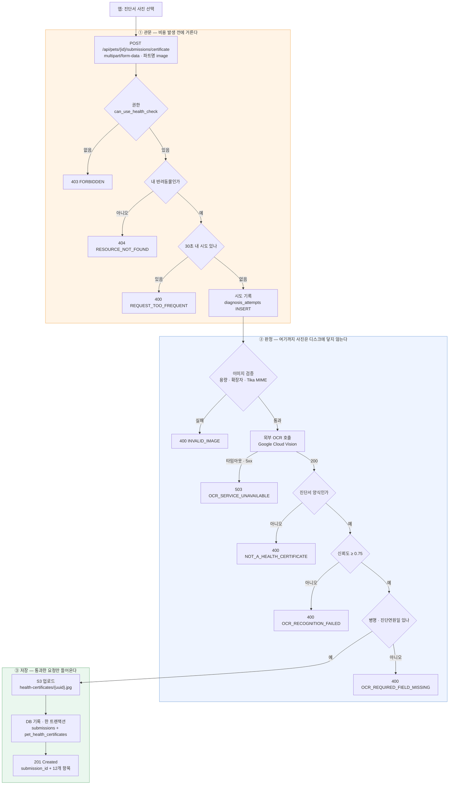
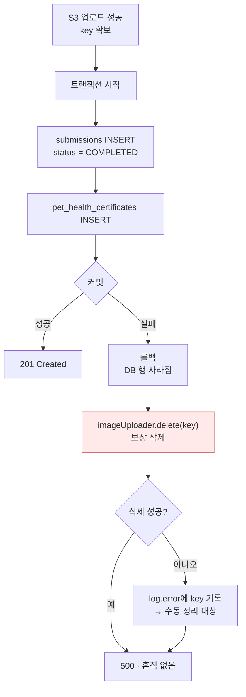
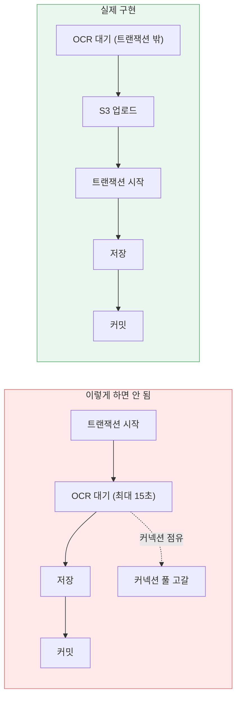
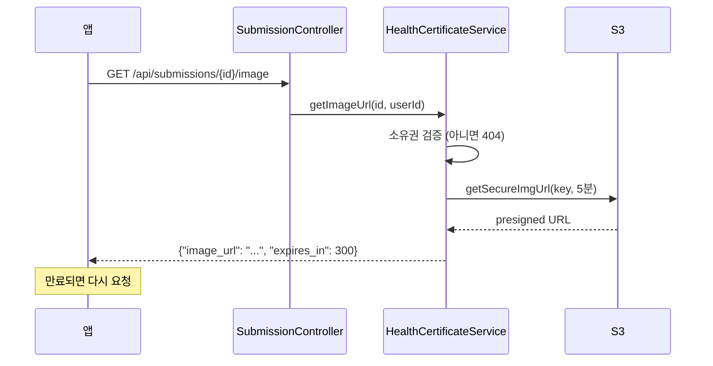
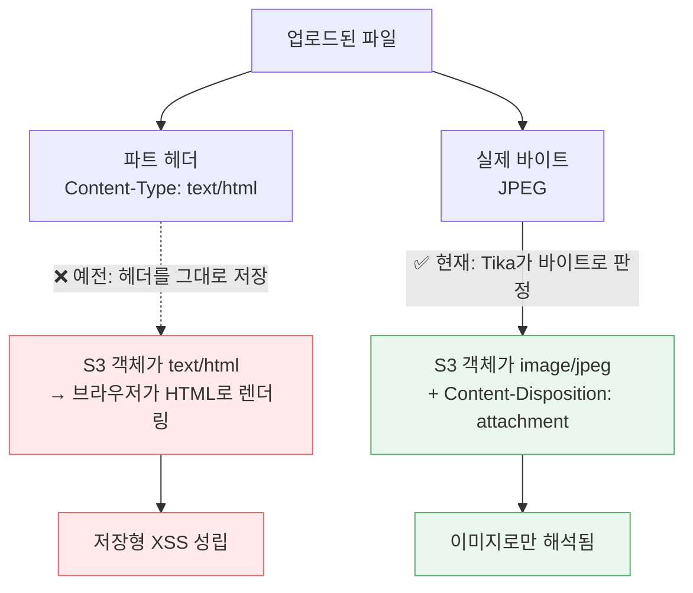
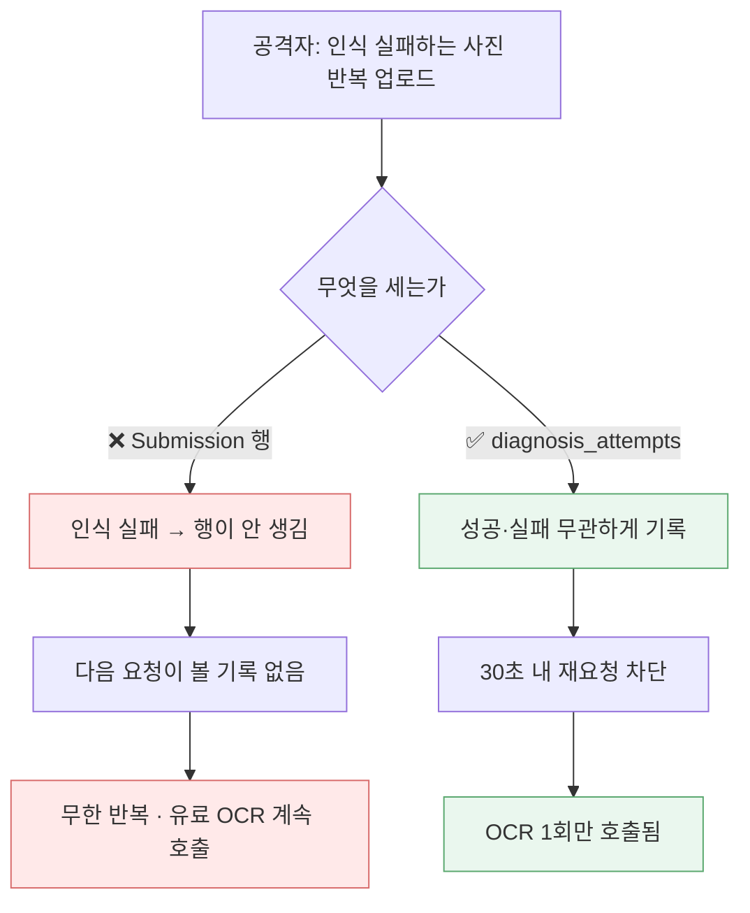
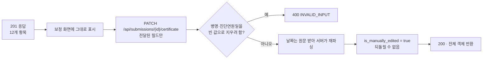
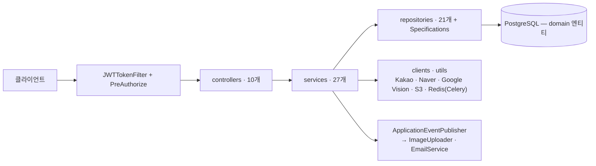

# 건강검진표 OCR — 사진 업로드 흐름

`HEALTH-01` · `POST /api/pets/{id}/submissions/certificate`

> **핵심 한 줄**
> 인식 판정이 전부 끝난 **뒤에야** 사진이 S3에 올라가고 DB 행이 생긴다.
> 그래서 실패 경로에는 되돌릴 것이 아예 없다.

---

## 1. 전체 흐름

**읽는 법** — ②번 상자 안에서 빠져나가는 화살표는 전부 `400`/`503`이고, 그중 어느 것도 S3나 `submissions` 테이블을 건드리지 않는다. 저장은 ③번 상자에서 처음 일어난다.

---

## 2. 사진이 S3까지 가는 길 (업로드 구간 확대)

```mermaid
flowchart LR
    A["MultipartFile"] --> B["validateImageFile()<br/>빈 파일 · 7MB · 확장자 · Tika"]
    B --> C["file.getBytes()<br/>힙에 전체 적재"]
    C --> D["SubmissionImageUploadEvent<br/>※ 이벤트 발행 아님 · 값 객체로 전달"]
    D --> E["imageUploader.storeSubmissionImage(event, prefix)"]
    E --> F["Tika로 바이트 재판정<br/>→ contentType · 확장자 결정"]
    F --> G["s3Client.putObject()<br/>SSE AES256 · attachment"]
    G --> H["S3 object key 반환"]
    H --> I["submissions.photo_url 에 저장"]
```

`SubmissionImageUploadEvent`는 이름만 이벤트다. 동기 경로에서는 `ApplicationEventPublisher`에 발행하지 않고 **인자로 그대로 넘긴다** — 같은 목적의 파라미터 객체를 새로 만들지 않기 위해서다.

---

## 3. 저장 중 실패하면 — 보상 삭제

S3는 트랜잭션에 참여하지 않는다. 사진이 올라간 뒤 DB가 실패하면 주인 없는 객체가 남으므로 직접 지운다.

> 이 저장소에 **S3 삭제 코드가 들어간 건 이번이 처음**이다. 기존에는 프로필 사진을 바꿔도 옛 객체가 그대로 남았다.

---

## 4. 왜 트랜잭션 밖에서 OCR을 호출하나

진입 메서드는 비트랜잭션이고, 저장 구간만 `TransactionTemplate`으로 묶는다.

---

## 5. 올린 사진 다시 보기

원본은 절대 공개 URL로 나가지 않는다. 5분짜리 서명 URL만 발급한다.

| 메서드 | prod 동작 | 진단서에 사용 |
|---|---|---|
| `getImgUrl(key)` | CloudFront **무서명·무만료** URL | ❌ 절대 금지 |
| `getSecureImgUrl(key, ttl)` | 서명 URL, 지정 시간 만료 | ✅ 이것만 사용 |

상세 조회 응답의 `photoUrl`은 **항상 `null`** 이다. 이미지는 위 전용 엔드포인트로만 나간다.

---

## 6. 저장할 때 Content-Type을 다시 판정하는 이유

클라이언트가 보낸 헤더를 그대로 믿으면, 유효한 JPEG 안에 스크립트를 심은 파일이 `text/html`로 저장된다. 서명 URL로도 막히지 않는 저장형 XSS다.

확장자도 파일명이 아니라 Tika 판정값에서 뽑는다. **진단서뿐 아니라 프로필·반려동물 사진 경로에도 같은 결함이 있었고, 세 곳 모두 고쳤다.**

---

## 7. 기존 눈·소변 진단과의 차이

같은 `S3Uploader` 구현을 공유하지만, 실행 순서가 다르다.

```mermaid
flowchart TD
    subgraph ASYNC["눈 · 소변 — 비동기"]
        A1["요청"] --> A2["Submission 생성<br/>PENDING"]
        A2 --> A3["커밋 + 즉시 201 응답"]
        A3 --> A4["(커밋 후) S3 업로드"]
        A4 --> A5["Quartz가 20초마다 수거"]
        A5 --> A6["Redis → Celery → 파이썬 워커"]
        A6 --> A7["워커가 PATCH로 결과 콜백"]
    end

    subgraph SYNC["진단서 — 동기"]
        B1["요청"] --> B2["OCR 호출 · 판정"]
        B2 --> B3["S3 업로드"]
        B3 --> B4["Submission 생성<br/>COMPLETED"]
        B4 --> B5["201 응답 (결과 포함)"]
    end

    style ASYNC fill:#eef4ff,stroke:#6b9bd8
    style SYNC fill:#eaf7ee,stroke:#5ba86f
```

| | 눈 · 소변 | 진단서 |
|---|---|---|
| 응답 시점 | 즉시 | OCR 완료 후 (최대 15초) |
| 최초 상태 | `PENDING` | `COMPLETED` |
| Quartz 배치 | 수거함 | **수거 안 함** |
| 실패 시 | `FAILED` 행이 남음 | **행 자체가 없음** |
| 응답 본문 | 비어 있음 | `submission_id` + 결과 |

진단서는 처음부터 `COMPLETED`라, `PENDING`만 집는 `PushAIInferenceTasks`와 `PROCESSING`만 집는 `RetryAIInferenceTasks` 어느 쪽도 건드리지 않는다. Celery 큐로 샐 경로가 구조적으로 없다.

---

## 8. 빈도 제한이 제출 행이 아니라 "시도"를 세는 이유

**비용을 발생시키는 요청만 정확히 제한을 빠져나가는** 구조였다. 그래서 시도 기록이 OCR 호출보다 앞에 있고, 별도 트랜잭션으로 즉시 커밋된다.

제한은 **유형별로 분리**되어 있다 — 진단서를 올린 직후 눈 진단이 "요청이 너무 잦다"며 거부되지 않는다.

---

## 9. 실패 코드 한눈에

| 상태 | 코드 | 언제 | 사용자 안내 |
|---|---|---|---|
| 400 | `INVALID_IMAGE` | 형식·용량 위반, 빈 파일 | 다른 사진 선택 |
| 400 | `REQUEST_TOO_FREQUENT` | 30초 내 재요청 | 잠시 후 재시도 |
| 400 | `NOT_A_HEALTH_CERTIFICATE` | 진단서 양식 아님 | **재촬영 유도** |
| 400 | `OCR_RECOGNITION_FAILED` | 신뢰도 0.75 미만 | **더 밝고 선명하게 재촬영** |
| 400 | `OCR_REQUIRED_FIELD_MISSING` | 병명·진단연원일 미검출 | **재촬영 유도** |
| 404 | `RESOURCE_NOT_FOUND` | 없거나 타인의 반려동물 | — |
| 503 | `OCR_SERVICE_UNAVAILABLE` | OCR 타임아웃·장애 | 잠시 후 재시도 |

타인의 리소스는 **항상 404**다. 403을 주면 "그 ID의 반려동물이 존재한다"는 사실이 새어나간다.

---

## 10. 업로드 후 보정 화면

OCR이 틀리게 읽은 항목을 사용자가 고칠 수 있다.

날짜는 파싱에 실패해도 등록을 막지 않는다. 원문(`2020.10.28`)은 보존하고 `DATE` 컬럼만 비워 둔 뒤, 이 화면에서 보정한다.

---

## 참고 — 설정값

| 항목 | 값 | 환경변수 |
|---|---|---|
| 업로드 상한 | 7MB | `UPLOAD_IMAGE_MAX_SIZE_BYTES` |
| 신뢰도 임계값 | 0.75 | (yml 고정) |
| 요청 간격 | 30초 | `OCR_USER_INTERVAL_SECONDS` |
| 서명 URL 만료 | 300초 | `HEALTH_CERTIFICATE_IMAGE_URL_EXPIRATION_SECONDS` |
| OCR 타임아웃 | 연결 10초 / 읽기 15초 | (yml 고정) |

7MB인 이유: 진단서의 작은 인쇄 글자를 읽어야 해 더 낮추면 인식 실패율이 오르고, Vision이 이미지를 base64로 보내 약 1.33배로 불어나므로 더 높이면 요청 크기 한도에 걸린다.

---
---

# 전체 API 구조 — URI · Controller · Service · Repository

> 아래는 `src/main/java/com/smarthealthdog/backend` 전체를 훑어 정리한 **엔드포인트 → 레이어** 지도다.
> 위쪽 OCR 문서가 "한 기능을 깊게"라면, 이 문서는 "전 기능을 넓게"다.

---

## 0. 공통 규약 — 모든 표를 읽기 전에

| 항목 | 내용 |
|---|---|
| 인증 방식 | 상태 없는 JWT. `JWTTokenFilter`가 `UsernamePasswordAuthenticationFilter` 앞에서 동작 |
| 인증 없이 열린 경로 | `/api/auth/**`, `/uploads/**`, `/swagger-ui/**`, `/v3/api-docs/**` — **그 외 전부 `authenticated()`** |
| 인가 방식 | 역할(Role)이 아니라 **권한(Permission) 문자열** 기준 → `@PreAuthorize("hasAuthority('can_edit_pet')")` |
| JWT subject | `user.public_id` (UUID) |
| 컨트롤러가 쓰는 식별자 | `Long.parseLong(userDetails.getUsername())` → **내부 숫자 `user.id`** (UserDetails의 username에 숫자 PK가 담겨 있다) |
| 에러 응답 | `ErrorMessage(codes, messages)` — `GlobalExceptionHandler`가 모든 예외를 변환 |
| 레이어 규칙 | `controllers` → `services` → `repositories` → `domain`. 컨트롤러는 **원칙적으로 서비스 메서드 하나만 호출** |

**레이어 그림**

---

## 1. 엔드포인트 전체 표

### 1-1. 인증 — `AuthController` (`/api/auth`, 전부 인증 불필요)

의존: `AuthenticationManager`, `AuthService`

| Method | URI | 요청 | Service | Repository |
|---|---|---|---|---|
| POST | `/api/auth/register` | multipart: `request`(**UserCreateRequest**) + `profilePicture`(옵션) | `AuthService.registerUser` → `UserService.createUser`, `EmailVerificationService.verifyEmailToken`, `FileUploadService` | `UserRepository`, `EmailVerificationRepository`, `RoleRepository` |
| POST | `/api/auth/register/send-email-verification` | **EmailVerificationCodeRequest** | `AuthService.sendEmailVerification` → `EmailVerificationService.sendEmailVerification` | `EmailVerificationRepository` |
| POST | `/api/auth/login` | **LoginRequest** | `AuthenticationManager` → `CustomUserDetailsService.loadUserByUsername`(이메일 분기), 이어서 `AuthService.generateTokens` | `UserRepository`, `RefreshTokenRepository` |
| POST | `/api/auth/logout` | **RefreshTokenRequest** | `AuthService.invalidateRefreshToken` → `RefreshTokenService.revokeRefreshToken` | `RefreshTokenRepository` |
| POST | `/api/auth/token/refresh` | **RefreshTokenRequest** | `AuthService.refreshAccessToken` → `RefreshTokenService.rotateRefreshToken` | `RefreshTokenRepository`, `UserRepository` |
| POST | `/api/auth/login/social/kakao` | **CreateSocialKakaoUserRequest**(`accessToken`) | `AuthService.loginUserViaKakaoInfo` → `OAuthClient`, `SocialLoginUserService`, `UserService` | `SocialLoginUserRepository`, `SocialLoginProviderRepository`, `UserRepository` |
| POST | `/api/auth/login/social/kakao/code` | **KakaoAuthorizationCodeRequest**(`code`) | `AuthService.loginUserViaKakaoAuthorizationCode` — 카카오 토큰 발급까지 백엔드가 수행 | 위와 동일 |

로그인 계열 응답은 전부 **`LoginResponse`**(access/refresh 토큰), 가입·인증코드 전송은 `201`, 로그아웃은 `204`.

### 1-2. 내 정보 — `UserController` (`/api/users`)

의존: `UserService`, `WalkService`

| Method | URI | 권한 | 요청/파라미터 | Service | Repository |
|---|---|---|---|---|---|
| GET | `/api/users/me/profile` | `can_view_own_profile` | — | `UserService.getUserProfileById` | `UserRepository` |
| PATCH | `/api/users/me` | `can_edit_own_profile` | multipart: `request`(**UpdateUserProfileRequest**) + `profilePicture` | `UserService.updateUserProfile` → `FileUploadService`, `NicknameValidator` | `UserRepository` |
| GET | `/api/users/me/walks/summary/weekly-comparison` | `can_view_weekly_summary` | `timezone` | `WalkService.weeklyComparison` + `DateUtils` | `WalkRepository.aggregateByUserAndPeriod` |
| GET | `/api/users/me/walks/this-week` | `can_view_own_walk_records` | `timezone` | `WalkService.listThisWeekWalks` | `WalkRepository` |

### 1-3. 반려동물 — `PetController` (`/api/pets`)

의존: `PetService`, `AIDiagnosisClientService`, `HealthCertificateService`, `ImgUtils`

| Method | URI | 권한 | 요청 | Service | Repository |
|---|---|---|---|---|---|
| POST | `/api/pets` | `can_add_pet` | multipart: `request`(**CreatePetRequest**) + `profilePicture` | `PetService.create` | `UserRepository`, `PetRepository` |
| GET | `/api/pets` | `can_view_own_pets` | — | `PetService.listByOwner` | `PetRepository.findByOwnerId` |
| GET | `/api/pets/{id}` | `can_view_own_pet_detail` | — | `PetService.get` — 소유권 비교는 **컨트롤러에서** 하고 불일치 시 `RESOURCE_NOT_FOUND` | `PetRepository` |
| PUT | `/api/pets/{id}` | `can_edit_pet` | multipart: `request`(**UpdatePetRequest**) + `profilePicture` | `PetService.update` | `PetRepository` |
| PATCH | `/api/pets/{id}` | `can_edit_pet` | multipart: `request`(**PartialUpdatePetRequest**) + `profilePicture` | `PetService.partialUpdate` | `PetRepository` |
| DELETE | `/api/pets/{id}` | `can_delete_pet` | — | `PetService.delete` → `204` | `PetRepository` |
| POST | `/api/pets/{id}/submissions/eye` | `can_use_health_check` | multipart: `image` | `AIDiagnosisClientService.performEyeDiagnosis` → `PetService`, `SubmissionService`, `FileUploadService` | `PetRepository`, `SubmissionRepository` |
| POST | `/api/pets/{id}/submissions/urine` | `can_use_health_check` | multipart: `image` | `AIDiagnosisClientService.performUrineDiagnosis` | `PetRepository`, `SubmissionRepository` |
| POST | `/api/pets/{id}/submissions/certificate` | `can_use_health_check` | multipart: `image` | `HealthCertificateService.register` — **동기**, 위 OCR 문서 참고 | `PetHealthCertificateRepository`, `SubmissionRepository`, `DiagnosisAttemptRepository` |

눈·소변은 **비동기**다 — `201`만 돌려주고 본문이 없다. 진단서만 `HealthCertificateResult`를 바로 담아 준다.

### 1-4. 산책 — `WalkController` (`/api/pets/{petId}/walks`) · `WalkQueryController` (베이스 경로 없음)

의존: 둘 다 `WalkService`만

| Method | URI | 권한 | 요청/파라미터 | Service | Repository |
|---|---|---|---|---|---|
| POST | `/api/pets/{petId}/walks` | `can_start_walk` | **CreateWalkRequest** | `WalkService.create` | `WalkRepository`, `PetRepository`(via `PetService`) |
| PATCH | `/api/pets/{petId}/walks/{walkId}/end` | `can_end_walk` | **EndWalkRequest** | `WalkService.end` | `WalkRepository` |
| GET | `/api/pets/{petId}/walks` | `can_view_own_walk_records` | `timezone`, `start_date`, `end_date`, `sort_by`(기본 `date_desc`), `limit`(20), `offset`(0) | `WalkService.listByPet` — 페이징은 **컨트롤러에서 잘라낸다** | `WalkRepository.findByPetIdAndStartTimeBetween…` |
| GET | `/api/walks/{walkId}` | `can_view_own_walk_detail` | — | `WalkService.get` | `WalkRepository` |
| DELETE | `/api/walks/{walkId}` | `can_delete_walk_record` | — | `WalkService.delete` → `204` | `WalkRepository` |

응답 키는 snake_case 수동 조립(`walk_id`, `pet_id`, `start_time`, `WalkResponse.toDetailSnake`)이다 — 이 두 컨트롤러만의 관례다. 날짜 파싱 실패는 컨트롤러가 직접 `400` 바디를 만들어 반환하므로 `ErrorMessage` 형식이 아니다.

### 1-5. 일광 노출 — `SunlightController` (`/api/pets/{petId}`)

의존: `SunlightService`

| Method | URI | 권한 | 요청 | Service | Repository |
|---|---|---|---|---|---|
| POST | `/api/pets/{petId}/walks/{walkId}/light-samples` | `can_start_walk` | **LightSampleBatchRequest**(배치) | `SunlightService.saveSamples` | `LightSensorSampleRepository.insertIgnoreDuplicate`, `WalkRepository` |
| GET | `/api/pets/{petId}/sunlight/today` | `can_view_own_walk_records` | — | `SunlightService.getTodayProgress` | `LightSensorSampleRepository.findByPetAndMeasuredAtBetween` |

응답은 각각 `{"result": …}`, `{"sunlight": …}`로 한 겹 감싼다.

### 1-6. 제출물(진단) — `SubmissionController` (`/api/submissions`)

의존: `SubmissionService`, `HealthCertificateService`

| Method | URI | 권한 | 요청/파라미터 | Service | Repository |
|---|---|---|---|---|---|
| GET | `/api/submissions` | `can_view_own_health_records` | `submittedFrom/To`, `completedFrom/To`(Instant), `type`(**SubmissionTypeEnum**), `Pageable`(기본 15건, `submittedAt DESC` + `status ASC`) | `SubmissionService.getSubmissionsByUserId` | `SubmissionRepository.findAll(Specification)` + `SubmissionSpecifications` |
| GET | `/api/submissions/pets/{petId}` | `can_view_own_health_records` | 위와 동일 | `SubmissionService.getSubmissionsByPetId` | 동일 |
| GET | `/api/submissions/{id}/eye` | `can_view_own_health_records` | `languageCode` | `SubmissionService.getSubmissionAndDiagnosesById` | `SubmissionRepository`, `DiagnosisRepository`, `ConditionTranslationRepository`, `LanguageRepository` |
| GET | `/api/submissions/{id}/urine` | `can_view_own_health_records` | `languageCode` | `SubmissionService.getSubmissionAndUrineMeasurementsById` | `UrineMeasurementRepository`, `UrineAnalyteRepository` |
| GET | `/api/submissions/{id}/certificate` | `can_view_own_health_records` | — | `SubmissionService.getSubmissionAndCertificateById` | `PetHealthCertificateRepository.findBySubmissionIdWithPet` |
| GET | `/api/submissions/{id}/image` | `can_view_own_health_records` | — | `HealthCertificateService.getImageUrl` → `ImgUtils` | `SubmissionRepository` |
| PATCH | `/api/submissions/{id}/eye` | `can_update_health_records` **(AI 워커 전용)** | **SubmissionResultRequest** | `SubmissionService.completeEyeTest` → `DiagnosisService.processInferenceResult` | `SubmissionRepository`, `DiagnosisRepository`, `ConditionRepository` |
| PATCH | `/api/submissions/{id}/urine` | `can_update_health_records` **(AI 워커 전용)** | **SubmissionUrineTestUpdateRequest** | `SubmissionService.completeUrineTest` → `UrineMeasurementService` | `UrineMeasurementRepository`, `UrineAnalyteRepository` |
| PATCH | `/api/submissions/{id}/status` | `can_update_health_records` **(AI 워커 전용)** | **SubmissionStatusUpdateRequest** | `SubmissionService.updateSubmissionStatusAfterInference` | `SubmissionRepository` |
| PATCH | `/api/submissions/{id}/certificate` | `can_use_health_check` | **UpdateHealthCertificateRequest** — 전달된 필드만 반영 | `HealthCertificateService.update` | `PetHealthCertificateRepository` |
| DELETE | `/api/submissions/{id}` | `can_use_health_check` | — | `SubmissionService.deleteSubmissionById` → `204` | `SubmissionRepository` |

`{id}`는 모두 **UUID**(`submission_id`)다. `PATCH` 3종은 파이썬 워커가 `AI_MODEL_SERVICE` 계정으로 호출하는 콜백이고, 완료 전이는 `PROCESSING` 상태에서만 받는다.

### 1-7. 병원 검색 — `HospitalSearchController` (`/api/hospitals`)

의존: `HospitalSearchService`

| Method | URI | 권한 | 파라미터 | Service | 외부 |
|---|---|---|---|---|---|
| GET | `/api/hospitals/search` | `can_view_hospitals` | `location`, `query`(24시·365·피부 등 키워드), `lat`, `lng`, `radius_km`(≤100), `sort_by`, `limit`(≤50), `offset` | `HospitalSearchService.search` | `NaverLocalSearchClient`, `NaverReverseGeocodingClient` |

**Repository 없음** — DB를 타지 않고 네이버 API 결과를 가공해 돌려준다. `location`도 `lat`+`lng`도 없으면 컨트롤러에서 `INVALID_INPUT`.

### 1-8. 보호소 — `ShelterSearchController` + `ShelterController` (둘 다 `/api/shelters`)

| Method | URI | 권한 | 파라미터 | Controller | Service | Repository |
|---|---|---|---|---|---|---|
| GET | `/api/shelters/search` | `isAuthenticated()` | `location`, `lat`, `lng`, `radius_km`, `sort_by`, `limit`, `offset` | `ShelterSearchController` | `ShelterSearchService.search` | `ShelterSearchRepository` |
| GET | `/api/shelters/{shelterId}` | 인증만 | — | `ShelterController` | `ShelterService.getProfile` | `ShelterRepository` |
| GET | `/api/shelters/{shelterId}/pets` | 인증만 | `status`, `limit`(20), `offset`(0) | `ShelterController` | `ShelterService.listAdoptionPets` | `ShelterRepository` |
| GET | `/api/shelters/{shelterId}/pets/{petId}` | 인증만 | — | `ShelterController` | `ShelterService.getAdoptionPetDetail` | `ShelterRepository` |

⚠️ 같은 베이스 경로를 **두 컨트롤러가 나눠 갖고 있다.** `/search`가 `/{shelterId}`와 겹쳐 보이지만 스프링은 리터럴 경로를 먼저 고르므로 동작엔 문제가 없다. 다만 `Shelter` 엔티티에 리포지토리가 둘(`ShelterRepository`, `ShelterSearchRepository`) 붙어 있는 건 정리 대상이다.

---

## 2. Service → Repository 의존 표

| Service | 직접 쓰는 Repository | 다른 Service / 외부 |
|---|---|---|
| `AuthService` | — | `EmailVerificationService`, `RefreshTokenService`, `RefreshTokenCleanupService`, `SocialLoginUserService`, `UserService`, `OAuthClient` |
| `UserService` | `UserRepository`, `SocialLoginUserRepository` | `SocialLoginProviderService`, `RoleService`, `FileUploadService`, `passwordEncoder`, `PasswordValidator`, `NicknameValidator`, `ImgUtils` |
| `CustomUserDetailsService` | `UserRepository` | — (인자가 UUID면 인증된 요청, 아니면 이메일 로그인으로 분기) |
| `RefreshTokenService` | `RefreshTokenRepository` | `RefreshTokenCleanupService`, `JWTUtils`, `UserService` |
| `RefreshTokenCleanupService` | `RefreshTokenRepository` | — |
| `EmailVerificationService` | `EmailVerificationRepository` | `ApplicationEventPublisher`, `TokenGenerator`, `tokenEncoder`, `EntityManager` |
| `DevEmailService` / `ProdEmailService` | — | `JavaMailSender` (프로필로 택일) |
| `RoleService` | `RoleRepository` | — |
| `SocialLoginProviderService` | `SocialLoginProviderRepository` | — |
| `SocialLoginUserService` | `SocialLoginUserRepository` | `SocialLoginProviderService` |
| `PetService` | `PetRepository`, `UserRepository` | `FileUploadService` |
| `WalkService` | `WalkRepository` | `PetService`, `DateUtils` |
| `SunlightService` | `LightSensorSampleRepository`, `WalkRepository` | `PetService` |
| `SubmissionService` | `SubmissionRepository`, `LanguageRepository`, `PetHealthCertificateRepository` | `ConditionService`, `DiagnosisService`, `UrineMeasurementService`, `SubmissionMapper` |
| `DiagnosisService` | `DiagnosisRepository` | `ConditionService` |
| `ConditionService` | `ConditionRepository`, `ConditionTranslationRepository` | — |
| `UrineMeasurementService` | `UrineMeasurementRepository` | `UrineAnalyteService` |
| `UrineAnalyteService` | `UrineAnalyteRepository` | — |
| `DiagnosisAttemptLimiter` | `DiagnosisAttemptRepository` | — (제출 행이 아니라 "시도"를 센다) |
| `AIDiagnosisClientService` | — | `FileUploadService`, `PetService`, `SubmissionService` |
| `HealthCertificateService` | `PetHealthCertificateRepository` | `PetService`, `SubmissionService`, `FileUploadService`, `DiagnosisAttemptLimiter`, `HealthCertificateOcrClient`, `HealthCertificateFieldExtractor`, `ImageUploader`, `ImgUtils`, `TransactionTemplate` |
| `FileUploadService` | — | `ApplicationEventPublisher` (업로드 자체는 이벤트로 넘긴다) |
| `HospitalSearchService` | — | `NaverLocalSearchClient`, `NaverReverseGeocodingClient` |
| `ShelterService` | `ShelterRepository` | — |
| `ShelterSearchService` | `ShelterSearchRepository` | — |

---

## 3. Repository → Entity → 테이블

| Repository | Entity | ID | 테이블 | 특징적인 메서드 |
|---|---|---|---|---|
| `UserRepository` | `User` | `Long` | `users` | `findByPublicId`, `findUserWithRoleAndPermissionsById/ByPublicId`, `incrementEmailVerificationFailCount` |
| `RoleRepository` | `Role` | `Long` | `roles` | `findByName(RoleEnum)` |
| `PermissionRepository` | `Permission` | `Integer` | `permissions` | 기본 CRUD만 |
| `RefreshTokenRepository` | `RefreshToken` | `UUID` | `refresh_tokens` | 만료 토큰 정리용 커스텀 쿼리 |
| `EmailVerificationRepository` | `EmailVerification` | `Long` | `email_verifications` | `incrementEmailVerificationTriesByEmail`, `lockEmailVerificationByEmail` |
| `SocialLoginProviderRepository` | `SocialLoginProvider` | `Short` | `social_login_provider` | `findByName` |
| `SocialLoginUserRepository` | `SocialLoginUser` | `Long` | `social_login_user` | `findByProviderAndProviderUserId` |
| `PetRepository` | `Pet` | `Long` | `pets` | `findByOwnerId` |
| `WalkRepository` | `Walk` | `Long` | `walks` | `findByPetIdAndStartTimeBetweenOrderByStartTime…`, `aggregateByUserAndPeriod`(→ `WeeklyAggRow` 프로젝션) |
| `LightSensorSampleRepository` | `LightSensorSample` | `Long` | `light_sensor_samples` | `insertIgnoreDuplicate`(중복 삽입 무시), `findByPetAndMeasuredAtBetween` |
| `SubmissionRepository` | `Submission` | `UUID` | `submissions` | `findSubmissionsWaitingToBeProcessedByAmount`, `updateStatusByIds`, `findByIdWithPetAndUserAndOwnerId`, `findAll(Specification)` |
| `SubmissionSpecifications` | — | — | — | 리포지토리가 아니라 **Specification 빌더 유틸** (사용자·반려동물·기간·타입 필터) |
| `DiagnosisRepository` | `Diagnosis` | `Long` | `diagnoses` | `findBySubmissionIdWithCondition` |
| `DiagnosisAttemptRepository` | `DiagnosisAttempt` | `Long` | `diagnosis_attempts` | `existsByUserIdAndTypeAndAttemptedAtAfter`, `deleteStaleAttempts` |
| `PetHealthCertificateRepository` | `PetHealthCertificate` | `Long` | `pet_health_certificates` | `findBySubmissionId`, `findBySubmissionIdWithPet` |
| `UrineMeasurementRepository` | `UrineMeasurement` | `Long` | `urine_measurements` | `findMeasurementBySubmissionWithAnalyte` |
| `UrineAnalyteRepository` | `UrineAnalyte` | `Integer` | `urine_analytes` | 기본 CRUD만 |
| `ConditionRepository` | `Condition` | `Integer` | `conditions` | `findByName`, `findBySpecies` |
| `ConditionTranslationRepository` | `ConditionTranslation` | `Integer` | `condition_translations` | `findByConditionIdsAndLanguage` |
| `LanguageRepository` | `Language` | `Integer` | `languages` | `findByCode` |
| `ShelterRepository` | `Shelter` | `Long` | `shelters` | 기본 CRUD |
| `ShelterSearchRepository` | `Shelter` | `Long` | `shelters` | `findByNameContainingIgnoreCase`, `findByAddressContainingIgnoreCase` |

---

## 4. HTTP 요청 밖에서 도는 것들

엔드포인트가 없어도 같은 서비스·리포지토리를 쓰는 경로가 있다. 구조 지도에서 빠지면 안 되는 부분이다.

| 트리거 | 클래스 | 하는 일 | Repository |
|---|---|---|---|
| Quartz 20초 (dev만) | `jobs/PushAIInferenceTasks` | `PENDING` 배치를 Redis 리스트 `celery`로 RPUSH → `PROCESSING` 전이 | `SubmissionRepository` |
| Quartz 1분 | `jobs/RetryAIInferenceTasks` | 타임아웃된 `PROCESSING` 재큐, 한도 초과 시 `FAILED`·`TIMEOUT` | `SubmissionRepository` |
| Quartz 10분 | `jobs/RemoveServiceFailureAIInferenceTasks` | `SERVICE_ERROR`·`TIMEOUT` 건을 `DELETED`로 소프트 삭제 | `SubmissionRepository` |
| 스케줄 | `RefreshTokenCleanupService.removeExpiredTokens` | 만료 리프레시 토큰 삭제 | `RefreshTokenRepository` |
| 앱 이벤트 | `FileUploadService` → `*UploadEvent` → `ImageUploader`(`S3Uploader`) | 비동기 S3 업로드 (`@EnableAsync` + `taskExecutor`) | — |
| 앱 이벤트 | `EmailVerificationService` → `EmailVerificationCodeSentEvent` → `EmailService` | 인증 메일 발송 | — |

> prod 프로필에서는 `QuartzConfig`가 트리거를 등록하지 않는다 — **AI 추론 잡이 돌지 않는다.** 동기 처리인 건강검진표 OCR만 prod에서 온전히 동작한다.

---

## 5. 한 장 요약

| 도메인 | Controller | 대표 Service | 대표 Repository |
|---|---|---|---|
| 인증·토큰 | `AuthController` | `AuthService` | `UserRepository`, `RefreshTokenRepository` |
| 내 정보 | `UserController` | `UserService` | `UserRepository` |
| 반려동물 | `PetController` | `PetService` | `PetRepository` |
| 산책 | `WalkController`, `WalkQueryController` | `WalkService` | `WalkRepository` |
| 일광 | `SunlightController` | `SunlightService` | `LightSensorSampleRepository` |
| AI 진단(눈·소변) | `PetController`(제출), `SubmissionController`(콜백·조회) | `AIDiagnosisClientService`, `SubmissionService` | `SubmissionRepository`, `DiagnosisRepository`, `UrineMeasurementRepository` |
| 건강검진표 OCR | `PetController`(등록), `SubmissionController`(조회·수정) | `HealthCertificateService` | `PetHealthCertificateRepository` |
| 병원 검색 | `HospitalSearchController` | `HospitalSearchService` | **없음** — 네이버 API |
| 보호소 | `ShelterController`, `ShelterSearchController` | `ShelterService`, `ShelterSearchService` | `ShelterRepository`, `ShelterSearchRepository` |
