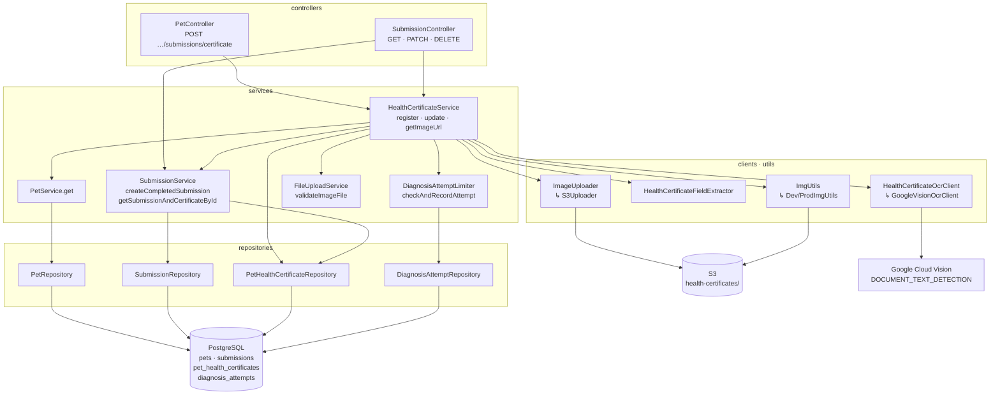
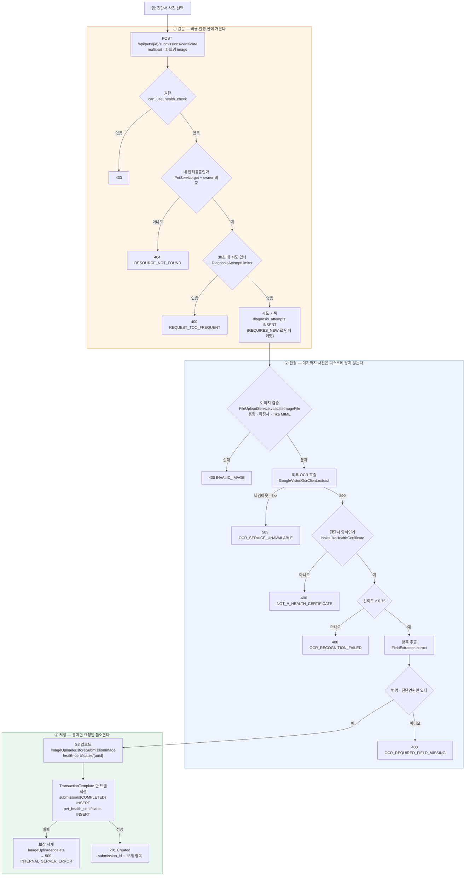
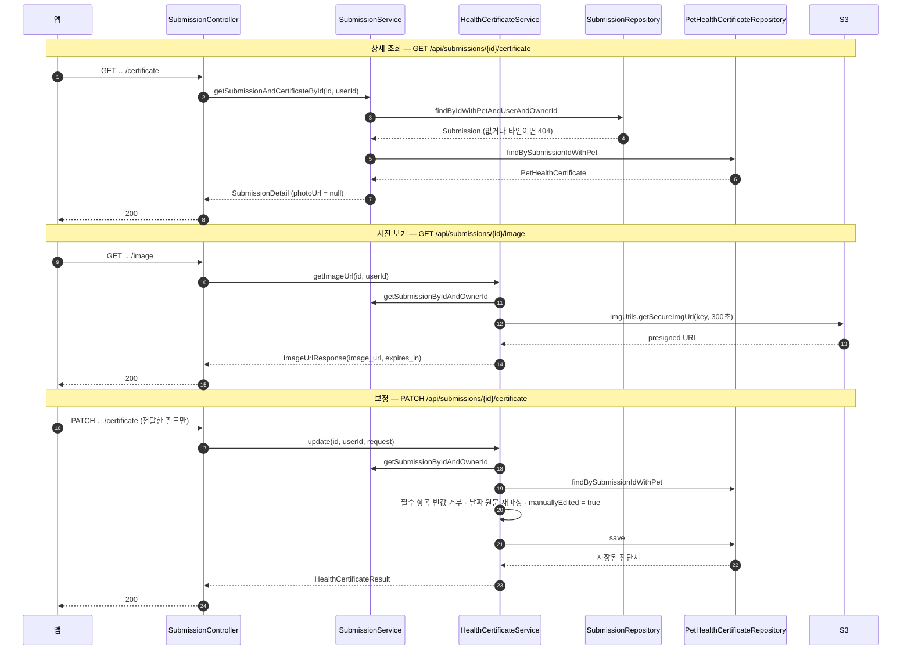

# 건강검진표 OCR — 구조와 흐름

`HEALTH-01` · 브랜치 `OCR/V2` · 커밋 `d270449 Feat: 건강검진표 OCR 등록 기능 구현`

> **핵심 한 줄**
> 인식 판정이 전부 끝난 **뒤에야** 사진이 S3에 올라가고 DB 행이 생긴다.
> 그래서 실패 경로에는 되돌릴 것이 아예 없다.

---

## 1. 엔드포인트 — URI · Controller · Service · Repository

진단서 기능은 엔드포인트 **4개**다. 등록만 `PetController`에 있고, 나머지는 제출물(submission) 자원이므로 `SubmissionController`에 있다.

| # | Method | URI | Controller | Service | Repository |
|---|---|---|---|---|---|
| 1 | POST | `/api/pets/{id}/submissions/certificate` | `PetController.addHealthCertificate` | `HealthCertificateService.register` | `PetRepository` → `SubmissionRepository` → `PetHealthCertificateRepository` (+ `DiagnosisAttemptRepository`) |
| 2 | GET | `/api/submissions/{id}/certificate` | `SubmissionController.getCertificateSubmissionById` | `SubmissionService.getSubmissionAndCertificateById` | `SubmissionRepository.findByIdWithPetAndUserAndOwnerId`, `PetHealthCertificateRepository.findBySubmissionIdWithPet` |
| 3 | PATCH | `/api/submissions/{id}/certificate` | `SubmissionController.updateCertificate` | `HealthCertificateService.update` | `SubmissionRepository`, `PetHealthCertificateRepository.findBySubmissionIdWithPet` → `save` |
| 4 | GET | `/api/submissions/{id}/image` | `SubmissionController.getSubmissionImageUrl` | `HealthCertificateService.getImageUrl` | `SubmissionRepository` |

삭제는 진단서 전용이 아니라 제출물 공통 엔드포인트를 쓴다.

| Method | URI | Controller | Service | Repository |
|---|---|---|---|---|
| DELETE | `/api/submissions/{id}` | `SubmissionController.deleteSubmissionById` | `SubmissionService.deleteSubmissionById` (소프트 삭제 → `DELETED`) | `SubmissionRepository` |

### 요청 / 응답 / 권한

| # | 권한 | 요청 | 성공 응답 |
|---|---|---|---|
| 1 | `can_use_health_check` | `multipart/form-data`, 파트명 **`image`** | `201 Created` + **`HealthCertificateResult`** |
| 2 | `can_view_own_health_records` | `{id}` = submission UUID | `200` + **`SubmissionDetail<HealthCertificateResult>`** (`photoUrl`은 **항상 null**) |
| 3 | `can_use_health_check` | `application/json`, **`UpdateHealthCertificateRequest`** | `200` + **`HealthCertificateResult`** |
| 4 | `can_view_own_health_records` | `{id}` = submission UUID | `200` + **`ImageUrlResponse`**(`image_url`, `expires_in`) |
| 삭제 | `can_use_health_check` | — | `204 No Content` |

`{id}`는 등록(1번)에서만 **pet id(Long)** 이고, 나머지는 전부 **submission id(UUID)** 다.

---

## 2. 레이어 구성도



---

## 3. 등록 흐름 — `POST /api/pets/{id}/submissions/certificate`



### 단계별 책임

| 단계 | 호출 | Repository / 외부 | 비고 |
|---|---|---|---|
| 1 소유권 | `PetService.get(petId)` + `owner.id` 비교 | `PetRepository` | 타인 리소스 존재를 노출하지 않기 위해 403이 아니라 **404** |
| 2 빈도 제한 | `DiagnosisAttemptLimiter.checkAndRecordAttempt(ownerId, HEALTH_CERTIFICATE)` | `DiagnosisAttemptRepository.existsByUserIdAndTypeAndAttemptedAtAfter` → `deleteStaleAttempts` → `save` | 요청 1건 = 유료 OCR 1건이므로 **외부 호출보다 먼저**. `REQUIRES_NEW` 로 분리 커밋 |
| 3 이미지 검증 | `FileUploadService.validateImageFile` | — | 빈 파일 / 7MB 상한 / `.png·.jpg·.jpeg` / `FileUtils.isMIMEImage`(Tika) |
| 4 OCR | `HealthCertificateOcrClient.extract(bytes, contentType)` | Google Vision | **트랜잭션 밖**. 연결 10초 / 읽기 15초, **재시도 없음** |
| 5 판정 | `HealthCertificateService.evaluate` → `FieldExtractor` | — | 양식 키워드 → 신뢰도 → 필수 항목, 순서대로 |
| 6 S3 | `ImageUploader.storeSubmissionImage(event, "health-certificates/")` | S3 | 기존 `diagnoses/` 와 접두사를 섞지 않는다 |
| 7 DB | `SubmissionService.createCompletedSubmission` + `PetHealthCertificateRepository.save` | `SubmissionRepository`, `PetHealthCertificateRepository` | `TransactionTemplate`로 저장 구간만 묶는다. 실패 시 S3 **보상 삭제** |

> **왜 `@Transactional`을 메서드에 안 붙였나**
> 진입 메서드에 붙이면 OCR 응답을 기다리는 최대 15초 동안 DB 커넥션을 점유해 커넥션 풀이 고갈된다.
> 그래서 저장 구간만 `TransactionTemplate`으로 감쌌다.

---

## 4. 조회 · 수정 · 이미지 · 삭제 흐름



### 조회 응답에서 `photoUrl`이 항상 `null`인 이유

`SubmissionMapper.toSubmissionDetailForCertificate`가 의도적으로 `null`을 넣는다.
진단서 사진은 **소유권을 검증한 뒤 단기 서명 URL을 주는 전용 엔드포인트(`/image`)로만** 내보낸다 — 무서명 CloudFront URL이 응답에 섞여 새어나갈 경로를 원천 차단하려는 것이다. 같은 이유로 `getImageUrl`은 `ImgUtils.getImgUrl`(prod에서 무서명 CloudFront)이 아니라 `getSecureImgUrl`을 쓴다.

### 수정(PATCH)의 규칙

| 규칙 | 동작 |
|---|---|
| `null` 필드 | **변경 없음** |
| 빈 문자열 | "지우기 시도" — 필수 항목(`disease_name`, `diagnosed_date_text`)이면 `400 INVALID_INPUT` |
| 날짜 필드 | 원문(`*_date_text`)을 받아 서버가 `FieldExtractor.parseDate`로 재파싱해 `DATE` 컬럼까지 갱신 |
| 한 번이라도 수정 | `is_manually_edited = true` — **되돌릴 수 없다** |
| 검증 실패 코드 매핑 | `UpdateHealthCertificateRequestErrorCode` + `ValidErrorCodeFinder`의 `case "UpdateHealthCertificateRequest"` |

---

## 5. 클래스 지도

| 레이어 | 클래스 | 역할 |
|---|---|---|
| controller | `controllers/PetController` | 등록 1개. 원칙 그대로 **서비스 한 번만 호출**하고 `201` |
| controller | `controllers/SubmissionController` | 조회 · 수정 · 이미지 · 삭제 |
| service | `services/HealthCertificateService` | **이 기능의 중심.** `register` · `getImageUrl` · `update` + 내부 `evaluate` / `compensateImage` |
| service | `services/SubmissionService` | `createCompletedSubmission`(`COMPLETED`로 바로 생성), `getSubmissionAndCertificateById`, `getSubmissionByIdAndOwnerId`, `deleteSubmissionById` |
| service | `services/PetService` | `get(petId)` — 소유권 비교용 |
| service | `services/DiagnosisAttemptLimiter` | 사용자·유형별 빈도 제한. 제출 행이 아니라 **"시도"** 를 센다 |
| service | `services/FileUploadService` | `validateImageFile`만 사용 (업로드 이벤트 발행 경로는 쓰지 않는다) |
| client | `clients/ocr/HealthCertificateOcrClient` | 벤더 중립 인터페이스 — 비즈니스 코드는 이것만 안다 |
| client | `clients/ocr/GoogleVisionOcrClient` | `DOCUMENT_TEXT_DETECTION` 호출. `languageHints: ko`, 재시도 없음 |
| client | `clients/ocr/HealthCertificateFieldExtractor` | `looksLikeHealthCertificate` · `extract` · `parseDate`. 라벨 사전으로 항목을 뽑는다 |
| util | `utils/ImageUploader` → `S3Uploader` | `storeSubmissionImage(event, prefix)`, `delete(key)` |
| util | `utils/ImgUtils` → `Dev/ProdImgUtils` | `getSecureImgUrl(key, ttl)` |
| repository | `repositories/PetHealthCertificateRepository` | `findBySubmissionId`, `findBySubmissionIdWithPet`(fetch join), `save` |
| repository | `repositories/SubmissionRepository` | `findByIdWithPetAndUserAndOwnerId`, `save` |
| repository | `repositories/DiagnosisAttemptRepository` | `existsByUserIdAndTypeAndAttemptedAtAfter`, `deleteStaleAttempts` |
| repository | `repositories/PetRepository` | 소유권 확인 |
| domain | `domain/PetHealthCertificate` | 테이블 `pet_health_certificates` |
| domain | `domain/SubmissionTypeEnum.HEALTH_CERTIFICATE` | 눈·소변과 같은 제출물 유형 축에 추가된 값 |
| dto | `dto/health/HealthCertificateResult` | 등록·조회·수정 **공통 응답**(snake_case) |
| dto | `dto/health/UpdateHealthCertificateRequest` | 부분 수정 요청 |
| dto | `dto/health/ImageUrlResponse` | `image_url`, `expires_in` |
| dto | `dto/health/ocr/HealthCertificateOcrResult` | `fullText`, `confidence` — 벤더 중립 값 객체, **저장하지 않는다** |
| dto | `dto/diagnosis/get/SubmissionMapper` | `toSubmissionDetailForCertificate` |
| validation | `validation/UpdateHealthCertificateRequestErrorCode` | 필드명 → `ErrorCode` |

---

## 6. 데이터 — 엔티티와 테이블

`V56__create_pet_health_certificates.sql` (Flyway)

```
pet_health_certificates
├─ id                   BIGINT IDENTITY PK
├─ pet_id               BIGINT NOT NULL  → pets(id) ON DELETE CASCADE
├─ submission_id        UUID   NOT NULL  → submissions(id) ON DELETE CASCADE, UNIQUE
│
├─ animal_name          VARCHAR(255)  동물명
├─ species_text         VARCHAR(255)  종류 (원문)
├─ breed                VARCHAR(255)  품종
├─ gender_text          VARCHAR(255)  성별 (원문)
├─ coat_color           VARCHAR(255)  모색
├─ age_text             VARCHAR(255)  연령 (원문)
├─ features             TEXT          특징
├─ disease_name         TEXT   NOT NULL  병명          ◀ 필수
├─ onset_date           DATE          발병 연원일 (파싱 성공 시)
├─ onset_date_text      VARCHAR(64)   발병 연원일 (원문)
├─ diagnosed_date       DATE          진단 연원일 (파싱 성공 시)
├─ diagnosed_date_text  VARCHAR(64) NOT NULL  진단 연원일 (원문) ◀ 필수
├─ prognosis            TEXT          예후 소견
├─ remarks              TEXT          그외의 사항(비고)
│
├─ ocr_confidence       NUMERIC(5,4) NOT NULL   CHECK 0 ≤ x ≤ 1
├─ is_manually_edited   BOOLEAN NOT NULL DEFAULT FALSE
├─ created_at           TIMESTAMPTZ NOT NULL
└─ updated_at           TIMESTAMPTZ NOT NULL

INDEX  idx_pet_health_certificates_pet_id (pet_id)
INDEX  idx_pet_health_certificates_diagnosed_date (diagnosed_date)
```

설계상 중요한 두 가지:

- **원본 이미지 키는 이 테이블에 없다.** `submissions.photo_url`에만 있다 — 제출물 공통 축을 그대로 쓴다.
- **견주 성명·주소는 추출도 저장도 하지 않는다.** OCR 원응답에는 들어 있지만 화이트리스트한 **12개 항목**만 컬럼으로 두고, `HealthCertificateOcrResult`는 메모리에서만 다룬다. 응답 DTO에도 해당 필드가 존재하지 않는다.

### 추출 규칙 (`HealthCertificateFieldExtractor`)

| 항목 | 내용 |
|---|---|
| 양식 판별 키워드 | `진단서`, `병명`, `동물의 표시`, `동물의표시` — 하나도 없으면 진단서가 아니다 |
| 라벨 사전 | 항목별 복수 표기 지원 (`동물명`/`축명`, `종류`/`축종`, `모색`/`털색`, `연령`/`나이`, `병명`/`진단명`, `진단 연월일`/`진단연원일`/`진단일`, `그외의 사항`/`비고` …) |
| 매칭 순서 | **긴 라벨 우선**(길이 내림차순) — `진단 연원일`이 `진단일`보다 먼저 잡혀야 한다 |
| 구분자 | `: ： - – — . ·` 와 공백 |
| 날짜 | 정규식 파싱 성공 시에만 `DATE` 컬럼 채움. 실패해도 원문(`*_text`)은 남는다 |

---

## 7. 실패 코드 한눈에

| HTTP | ErrorCode | 발생 지점 | 메시지 |
|---|---|---|---|
| 403 | — (Spring Security) | `@PreAuthorize` | 권한 없음 |
| 404 | `RESOURCE_NOT_FOUND` | 소유권 불일치 / 없는 반려동물 · 제출 / `DELETED` 상태 | 요청한 리소스를 찾을 수 없습니다. |
| 404 | `HEALTH_CERTIFICATE_NOT_FOUND` | 제출은 있는데 진단서 행이 없음 | 건강검진 기록을 찾을 수 없습니다. |
| 400 | `REQUEST_TOO_FREQUENT` | `DiagnosisAttemptLimiter` | 진단 요청이 너무 자주 발생했습니다. |
| 400 | `INVALID_IMAGE` | `validateImageFile`, `getBytes()` 실패, 빈 바이트 | 이미지 파일이 유효하지 않거나 지원되지 않는 형식입니다. |
| 400 | `NOT_A_HEALTH_CERTIFICATE` | 양식 키워드 없음 | 진단서 양식으로 보이지 않는 이미지입니다. |
| 400 | `OCR_RECOGNITION_FAILED` | 신뢰도 < `min-confidence` | 더 밝고 선명한 사진으로 다시 시도해주세요. |
| 400 | `OCR_REQUIRED_FIELD_MISSING` | 병명 또는 진단 연원일 미검출 | 병명 또는 진단 연원일을 찾지 못했습니다. |
| 400 | `INVALID_INPUT` | PATCH에서 필수 항목을 빈 값으로 지우려는 시도 | 잘못된 입력입니다. |
| 503 | `OCR_SERVICE_UNAVAILABLE` | 연결 실패 · 타임아웃 · 외부 5xx | 인식 서비스에 일시적으로 연결할 수 없습니다. |
| 500 | `INTERNAL_SERVER_ERROR` | S3 업로드 실패, DB 저장 실패(보상 삭제 후) | 서버에서 예기치 않은 오류가 발생했습니다. |

모두 `GlobalExceptionHandler`를 거쳐 `ErrorMessage(codes, messages)` 형태로 나간다.

---

## 8. 설정값

| 키 | dev 값 | 환경변수 | 의미 |
|---|---|---|---|
| `ocr.google.api-key` | — | `GOOGLE_VISION_API_KEY` | GCP 콘솔에서 **Cloud Vision API만 허용**하도록 제한할 것 |
| `ocr.google.endpoint` | `https://vision.googleapis.com/v1/images:annotate` | — | |
| `ocr.google.language-hint` | `ko` | — | 한국어 진단서 |
| `ocr.google.connect-timeout-seconds` | `10` | — | |
| `ocr.google.read-timeout-seconds` | `15` | — | 이 값이 트랜잭션을 밖으로 뺀 이유 |
| `ocr.certificate.min-confidence` | `0.75` | — | 미달 시 `OCR_RECOGNITION_FAILED` |
| `ocr.user-interval.seconds` | `30` | `OCR_USER_INTERVAL_SECONDS` | 사용자·유형별 최소 요청 간격 |
| `health-certificate.image.presigned-url-expiration-seconds` | `300` | `HEALTH_CERTIFICATE_IMAGE_URL_EXPIRATION_SECONDS` | `/image` 서명 URL 수명 |
| `upload.image.max-size-bytes` | `7340032`(7MB) | `UPLOAD_IMAGE_MAX_SIZE_BYTES` | 상한의 단일 출처는 yml |

S3 키 접두사는 코드 상수다 — `HealthCertificateService.IMAGE_KEY_PREFIX = "health-certificates/"`. 기존 `diagnoses/` 와 섞지 않아 접근 정책·수명 주기 규칙을 따로 걸 수 있다.

---

## 9. 눈·소변 진단과의 차이

| 축 | 눈 · 소변 | 건강검진표 |
|---|---|---|
| 처리 방식 | **비동기** — Quartz가 Redis `celery` 큐에 넣고 파이썬 워커가 콜백 | **동기** — 요청 안에서 OCR까지 끝낸다 |
| 등록 응답 | `201`, 본문 없음 | `201` + `HealthCertificateResult` (프론트가 바로 보정 화면을 띄울 수 있게) |
| 제출 상태 흐름 | `PENDING` → `PROCESSING` → `COMPLETED`/`FAILED` | 처음부터 **`COMPLETED`** (`createCompletedSubmission`) |
| 이미지 업로드 시점 | 제출 행 생성 **후** 이벤트로 비동기 S3 업로드 | 판정 통과 **후** 동기 업로드 |
| 실패 시 남는 것 | 제출 행이 `FAILED`/`TIMEOUT`으로 남고 배치가 정리 | **아무것도 남지 않는다** (S3 객체도 DB 행도 없음) |
| 결과 수정 | 불가 (모델 출력) | `PATCH …/certificate`로 사용자 보정 |
| prod 동작 | `QuartzConfig`가 prod에서 트리거를 등록하지 않아 **추론 잡이 돌지 않는다** | 동기라서 **prod에서 그대로 동작** |
| 빈도 제한 기준 | `inference-service.interval.seconds` | `ocr.user-interval.seconds` (유료 호출이므로 별도) |

---

## 10. 테스트

| 파일 | 종류 | 대상 |
|---|---|---|
| `services/HealthCertificateServiceUT.java` | 단위 (`@ExtendWith(MockitoExtension.class)`) | 등록 분기, 판정 순서, 보상 삭제, 수정 규칙 |
| `services/HealthCertificateServiceTest.java` | 통합 (`@SpringBootTest`, `@ActiveProfiles("test")`) | 트랜잭션 경계, 리포지토리 연동 |
| `clients/ocr/HealthCertificateFieldExtractorUT.java` | 단위 | 라벨 사전 매칭, 날짜 파싱, 양식 판별 |

```bash
./gradlew test --tests 'HealthCertificateServiceUT'
./gradlew test --tests 'HealthCertificateFieldExtractorUT'
```

---

## 11. 남은 과제

- **고아 S3 객체 정리 배치.** 보상 삭제(`compensateImage`)마저 실패하면 키만 로그에 남기고 요청은 실패로 끝난다 — 수동 정리가 필요하다.
- `ocr_confidence`는 저장하되 응답에 그대로 노출된다. 프론트가 어떤 임계값으로 "확인해 주세요" 배지를 띄울지는 아직 합의 전이다.
- 날짜 파싱 실패 시 `DATE` 컬럼이 비어 통계 쿼리에서 빠진다. 보정 화면에서 사용자가 채우면 `parseDate`가 다시 돌지만, 끝까지 비어 있는 행을 어떻게 다룰지는 미정이다.
